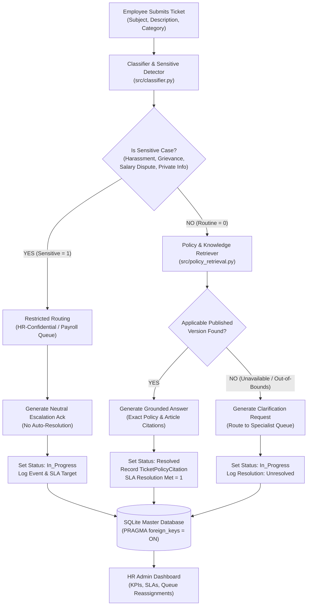
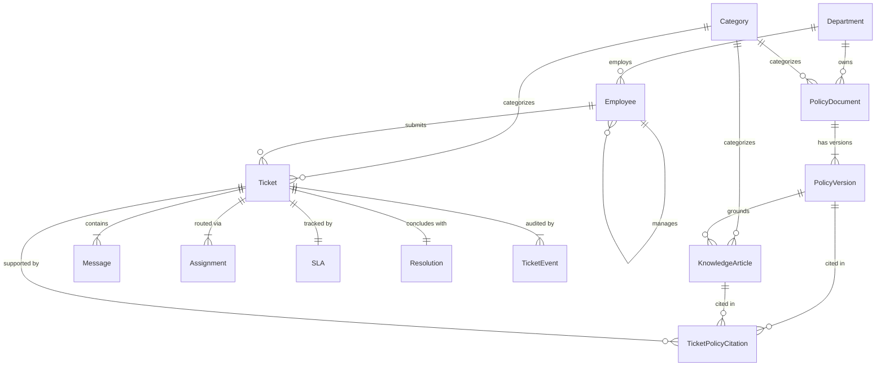

# AI-Powered HR Helpdesk — System Architecture

## 1. Executive Summary & Business Problem

The **AI-Powered HR Helpdesk** resolves routine employee human-resources inquiries automatically using strictly versioned company policy documents, while ensuring that sensitive, confidential, or legally risky cases are routed immediately to authorized human queues with zero automated disclosure.

### Key Capabilities
- **Deterministic Classification & Sensitive Case Protection:** Classifies inquiries across 5 categories and prevents automated resolution for harassment, discrimination, grievances, and salary disputes.
- **Strict Policy Grounding & Citation:** Cites the exact Policy Document, published Policy Version, and Knowledge Article. Never hallucinates policy guidelines.
- **Time-Aware Policy Versioning:** Dynamically resolves the applicable policy version based on effective date windows (`effective_from &le; ticket_date &le; effective_to`) and publication status (`Published` vs `Draft` vs `Retired`).
- **Configurable SLA Management:** Computes response and resolution deadlines respecting standard business working hours (skipping weekends and non-business hours), and flags overdue tickets in real-time.
- **Full Audit Trail:** Append-only message history, assignment history, and event logs.

---

## 2. End-to-End System Architecture



---

## 3. Database Entity-Relationship (ER) Diagram

The persistence layer consists of 13 interconnected SQLite tables enforced with strict foreign key constraints:



---

## 4. Component Responsibilities

| Component | File | Responsibilities |
|---|---|---|
| **Classification Engine** | `src/classifier.py` | Detects sensitive keywords, assigns category (`CAT-001` to `CAT-005`), priority (`Critical` to `Low`), routing queue (`HR-Confidential`, `Payroll`, etc.), and routing rationale. |
| **Grounded Policy Retriever** | `src/policy_retrieval.py` | Retrieves knowledge articles, checks publication status (`Published`), evaluates effective dates (`effective_from &le; T &le; effective_to`), filters stopwords, and excludes unsupported topics. |
| **Response Service** | `src/response_service.py` | Generates safe, grounded answers citing policy title, version number, and article snippet. Generates neutral, professional escalation acknowledgements for sensitive cases. |
| **SLA Service** | `src/sla_service.py` | Implements business hour calculations (skipping weekends and outside hours), calculates response and resolution deadlines, evaluates overdue tickets, and formats ticket age. |
| **Ticket Lifecycle Service** | `src/ticket_service.py` | Manages ticket creation, assignment transitions, status updates, message posting, citation logging, and KPI metric aggregations. |
| **Persistence Utility** | `src/database.py` | Connection factory, transactional context managers, parameterized query execution, and enforced SQLite foreign key integrity. |
| **Master Data Generator** | `src/generate_master_data.py` | Deterministic generation of 5 departments, 100 employees, 20 policies, 40 versions (Published, Retired, Draft), and 150 knowledge articles using seed `20261022`. |
| **Web Presentation** | `app.py`, `templates/`, `static/` | Flask routes, employee portal, administrative dashboard, policy versioning viewer, and responsive enterprise CSS UI. |

---

## 5. Policy Versioning & Effective Date Logic

Policies change over time. The system guarantees that tickets are resolved using the **currently applicable published version**, not simply the highest version number.

### Version Status Model
1. **`Published`**: Active policy currently in effect.
2. **`Retired`**: Historical version that has been superseded.
3. **`Draft`**: Upcoming version not yet published or effective.

### Selection Algorithm
```sql
SELECT pv.version_id, pv.version_number, pv.policy_text
FROM PolicyVersion pv
WHERE pv.policy_id = :policy_id
  AND pv.status = 'Published'
  AND pv.effective_from <= :ticket_as_of_date
  AND (pv.effective_to IS NULL OR pv.effective_to >= :ticket_as_of_date)
ORDER BY pv.version_number DESC
LIMIT 1;
```

**Key Proof in Codebase:**
- Policies `POL-HR-2026-001` to `POL-HR-2026-018`: Version 1 is `Retired` (ended 2026-03-31), Version 2 is `Published` (effective 2026-04-01). Version 2 is selected.
- Policies `POL-HR-2026-019` and `POL-HR-2026-020`: Version 1 is `Published` (effective 2026-01-01), Version 2 is `Draft` (effective 2027-01-01). The system **correctly selects Version 1**, proving it does not blindly pick `MAX(version_number)`.

---

## 6. Sensitive Case Guardrails

The application strictly enforces that sensitive inquiries are **never auto-resolved**:
1. When sensitive keywords (e.g. harassment, discrimination, salary discrepancy, grievance) are detected, `sensitive_flag` is set to `1`.
2. The ticket is immediately routed to `HR-Confidential` or `Payroll`.
3. The automated assistant sends a neutral acknowledgement explaining that a human specialist has been assigned.
4. Ticket status transitions to `In_Progress` (never `Resolved`).
5. An audit event is logged with the routing rationale.

---

## 7. Service-Level Agreement (SLA) & Working Calendar

### Target Deadlines by Priority
- **Critical:** Response SLA: 1 hour | Resolution SLA: 4 hours
- **High:** Response SLA: 4 hours | Resolution SLA: 24 hours
- **Medium:** Response SLA: 8 hours | Resolution SLA: 48 hours
- **Low:** Response SLA: 24 hours | Resolution SLA: 72 hours

### Working Calendar Engine
- **Standard Business Hours:** Monday to Friday, 09:00 to 17:00 UTC (8 hours/day).
- **Weekend Rollover:** Requests submitted on Friday after hours or over the weekend advance to Monday 09:00.
- **Overdue Tracking:** Any open/in-progress ticket whose `resolution_due_at` timestamp has passed is dynamically flagged as `OVERDUE` on the dashboard.
